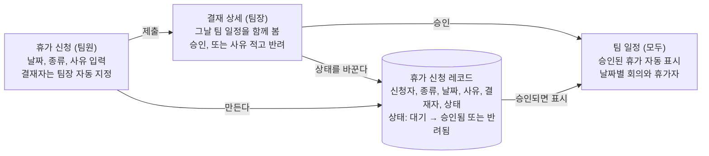

# BRGroupWare 해커톤 계획서 (초안)

2026-11-26 · 김경준

주제 제안: 휴가를 한 번 신청하면 결재부터 팀 일정 반영까지 끝나는 앱. 이미 띄워 둔 BRGroupWare 홈 시안(내가 처리할 일 + 오늘 일정)을 바탕으로 채운 초안이라, 회의에서 아래 네 가지부터 확인하고 바꾼다.

- [ ] 1번 예시 장면을 팀원이 실제로 겪은 장면으로 바꾸기
- [ ] 공고 기능 목록에 전자결재와 일정이 있는지 확인하기
- [ ] 해커톤 총 시간 확인하기 (6번 점검 시점은 비율로 적어 둠)
- [ ] 팀원 이름과 신입 발표자 정하기

## 1. 문제 정의

**팀원은 휴가 결재가 승인되면 같은 내용을 팀 일정에 다시 입력하고, 팀장은 그날 팀 일정을 다른 화면에서 찾아본 뒤에야 승인한다.**

예시 장면(실제 장면으로 교체): 정다은 님이 12/3 연차를 결재로 올렸다. 팀장은 그날 회의가 있는지 캘린더를 따로 열어 확인하느라 하루 뒤 승인했다. 승인 뒤 정다은 님은 팀 캘린더에 '정다은 연차'를 다시 적었다.

| 단계 | 지금 하는 방식 | 불편 |
| --- | --- | --- |
| 신청 | 결재 시스템에 휴가 신청서 작성 | 승인이 어디서 멈췄는지 알 수 없음 |
| 판단 | 팀장이 캘린더를 따로 열어 그날 일정 확인 | 화면 두 개를 오가며 판단 |
| 반영 | 승인 뒤 신청자가 팀 캘린더에 다시 입력 | 같은 정보 두 번 입력, 빠뜨리면 팀이 모름 |

## 2. 기획 목적

**팀원이 휴가를 한 번만 신청하면 팀장 승인부터 팀 일정 반영까지 한 번에 끝나게 한다.**

- 팀원: 팀 일정에 다시 적지 않는다. 신청 건이 어디까지 갔는지 홈에서 본다.
- 팀장: 결재 화면 안에서 그날 팀 일정을 보고 바로 판단한다.
- 팀 전체: 누가 언제 쉬는지 팀 일정 하나만 보면 된다.

## 3. 사용자와 시나리오

사용자는 둘이다. 휴가를 신청하는 **팀원(정다은)**, 승인하는 **팀장(박지훈)**. 업무는 4단계에서 끝난다.

1. **팀원**이 휴가 신청 화면에서 날짜, 종류, 사유를 넣고 제출한다. 결재자는 팀장으로 자동 지정된다.
2. **팀장**이 홈의 '내가 처리할 일'에서 신청 건을 연다. 같은 화면에 그날 팀 일정(회의, 다른 휴가자)이 함께 보인다.
3. **팀장**이 승인한다. 반려할 때는 사유를 적는다.
4. **팀원** 홈에 '승인됨'이 뜨고, 팀 일정 12/3 칸에 '정다은 연차'가 자동으로 생긴다. 여기서 업무가 끝난다.

## 4. 핵심 기능과 범위

공고 기능 중 **전자결재**와 **일정** 두 개를 쓴다. 아래 완료 조건이 모두 동작하면 필수 범위가 끝난 것이다.

| 기능 | 이번에 구현할 동작 | 완료 조건 |
| --- | --- | --- |
| 전자결재 | 휴가 신청서 제출 | 제출하면 팀장 '내가 처리할 일'에 1건이 생긴다 |
| 전자결재 | 승인과 반려 | 누르면 팀원 화면 상태가 '승인됨' 또는 '반려됨'으로 바뀐다. 반려는 사유를 적어야 눌린다 |
| 일정 | 승인된 휴가 자동 표시 | 승인 즉시 팀 일정 해당 날짜에 '이름 + 휴가 종류'가 보인다 |
| 일정 | 결재 화면에서 그날 일정 조회 | 결재 상세에 신청 날짜의 회의와 다른 휴가자가 보인다 |

시간이 남으면 추가할 항목:

- [ ] 신청 화면에 남은 연차 표시
- [ ] 반차와 시간 단위 휴가
- [ ] 승인 알림 (메뉴 배지, 알림 문구)
- [ ] 모바일 화면

이번에 안 하는 것: 로그인과 권한(시연은 사용자 전환 버튼으로 대신), 여러 단계 결재선, 실제 사내 시스템 연동.

## 5. 화면과 데이터

입력은 '휴가 신청', 판단은 '결재 상세', 결과 확인은 '홈'과 '팀 일정'에서 한다. 홈(내가 처리할 일 + 오늘 일정)은 이미 띄워 둔 BRGroupWare 시안을 그대로 쓴다.

휴가 신청 레코드 하나가 두 기능을 잇는다. 상태가 '승인됨'으로 바뀌는 순간 같은 레코드가 팀 일정 항목이 된다. 팀장은 홈의 '내가 처리할 일'에서 결재 상세로 들어간다.

시연용 데이터 1건:

| 항목 | 값 |
| --- | --- |
| 신청자 | 정다은 (해외사업팀) |
| 종류 | 연차 |
| 날짜 | 2026-12-03 (수), 하루 |
| 사유 | 개인 일정 |
| 결재자 | 박지훈 팀장 |
| 상태 | 대기, 승인 후 승인됨 |
| 그날 팀 일정 | 14:00 주간 해외사업 회의 (정다은 참석 예정) |
| 승인 후 생기는 일정 | 12/3 종일 '정다은 연차' (이 결재 건에서 자동 생성) |

데이터는 브라우저 localStorage에 저장한다. 같은 브라우저에서 사용자 전환으로 팀원과 팀장 화면을 오가면 시연에 충분하고, 서버 DB는 이번 범위 밖이다.

## 6. 실행 계획과 역할

5명 기준으로 나눠 두었다. 4명이면 기획·발표와 통합 검증을 한 사람이 맡는다.

| 역할 | 담당 | 맡는 일 | 끝났다는 기준 |
| --- | --- | --- | --- |
| 기획·발표 | (이름) | 문제 장면 확정, 시연 데이터 준비, 발표 흐름 | 시연 대본 |
| 화면 | (이름) | 휴가 신청, 결재 상세, 팀 일정 화면 (홈은 시안 재사용) | 화면 3개가 시연 데이터로 보임 |
| 기능 A: 전자결재 | (이름) | 신청 저장, 승인과 반려, 상태 표시 | 4번 전자결재 완료 조건 2개 |
| 기능 B: 일정 | (이름) | 승인 시 일정 생성, 날짜별 조회 | 4번 일정 완료 조건 2개 |
| 통합 검증 | (이름) | 시나리오 4단계 반복 점검, 버그 목록 관리 | 리허설 2회 무사통과 |

합쳐서 점검할 시점 (총 시간 대비 비율, 8시간이면 1차 통합은 약 3시간 지점):

1. **10%** 회의 결과(1~5번) 확정. 데이터 항목 이름을 신청자, 종류, 날짜, 사유, 결재자, 상태로 통일한다.
2. **40%** 1차 통합: 팀원이 신청하면 팀장 '내가 처리할 일'에 뜨는가 (화면 + 기능 A).
3. **70%** 2차 통합: 승인하면 팀 일정에 뜨는가 (기능 A + B). 이후로는 새 기능을 넣지 않는다.
4. **90%** 발표자 순서대로 시연 리허설 2회.

## 7. 산출물과 발표

시연에서 **팀원이 일정을 다시 입력하지 않고, 팀장이 다른 화면을 열지 않고 승인하면** 1번의 불편이 해결된 것이다.

- [ ] 동작하는 프로토타입 (BRGroupWare, 로컬 실행)
- [ ] 역할 분담표 (6번 표)
- [ ] 신입 발표자별 시연 순서 (아래 표)

| 순서 | 발표자 | 보여줄 장면 |
| --- | --- | --- |
| 1 | (신입 1) | 지금 방식 재연: 결재 올리고, 캘린더 따로 열고, 일정 다시 입력 |
| 2 | (신입 2) | 팀원 화면에서 12/3 연차 신청 |
| 3 | (신입 3) | 팀장 화면으로 전환, 그날 14시 회의를 보고 승인 |
| 4 | (신입 4) | 팀원 화면 '승인됨'과 팀 일정 12/3 자동 표시, 1번 장면과 비교하며 마무리 |
